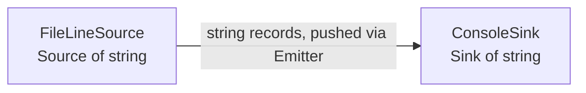

# LogFlow — Architecture

*Sections 1-8 describe Increment 1 (the skeleton), section 9 Increment 2, section 10 Increment 3 (composition). Later sections win where they disagree with earlier ones: the record type and `ConsoleSink` (section 9); the builder method is now `via()` instead of `then()`, `Sink` has lifecycle hooks, and `Pipeline` was extended (section 10).*

## Increment 1: The Skeleton Pipeline

## 1. The two-box diagram

At the end of week one the system is exactly two components joined by one connector.

```
   +--------------------+      Emitter<string>       +--------------------+
   |   FileLineSource   | -------------------------> |    ConsoleSink     |
   |  (a Source<string>)|   one record per line,     |  (a Sink<string>)  |
   |                    |   pushed, in order         |                    |
   +--------------------+                            +--------------------+
             ^                      ^                          ^
             |                      |                          |
             +---------- assembled and driven by Pipeline -----+
                        (Main only wires it up and calls run())
```



The **boxes** are components; the **arrow** is a connector. The pipeline's
value is not visible yet. Reading a file and printing it is deliberately
trivial, because week one is about getting the *shape* right.

## 2. Vocabulary

| Term | Meaning | Contract (header) |
|---|---|---|
| **Record** | One unit of data flowing through the system (a `std::string` this week) | – |
| **Source** | Where records come from; pushes them into an `Emitter` | `Source.hpp` |
| **Stage** | A step that turns each input into zero, one, or many outputs | `Stage.hpp` |
| **Sink** | Where records end up | `Sink.hpp` |
| **Emitter** | The place a component hands its output to | `Emitter.hpp` |
| **Pipeline** | The connector: an ordered chain source → stages → sink with a `run()` | `Pipeline.hpp` |

The five contracts delivered this week are `Stage`, `Emitter`, `Source`,
`Sink` and `StageException`.

## 3. Interface vs. implementation

| Interface (the contract) | Implementation (one way to honour it) |
|---|---|
| `Source<std::string>` | `FileLineSource` |
| `Sink<std::string>` | `ConsoleSink` |
| `Stage<I, O>` | none this week (tests contain several) |

The interfaces are small on purpose (one core method each). Everything that
changes from week to week (parsers, filters, aggregators, other sources and
sinks) is a new *implementation*; the interfaces and the `Pipeline` do not
change.

**Dependency rule:** `Pipeline.hpp` includes only the four interface headers.
It has never heard of `FileLineSource` or `ConsoleSink`. Only `Main.cpp`
knows the concrete classes, and it only uses them to choose what to plug in.

```
   Main.cpp ──uses──> FileLineSource ──implements──> Source<T> <──uses── Pipeline
       │                                                                    ^
       ├────────────uses──> ConsoleSink ──implements──> Sink<T>  <──uses────┤
       └────────────────────────────────── builds and calls run() ──────────┘
```

## 4. Design note: why `process` emits instead of returning

`Stage::process(input, out)` pushes results into an `Emitter` rather than
returning a value. A return value forces a **1 : 1** relationship between
inputs and outputs. Real stages are not like that:

- a **filter** produces *zero* outputs for records it rejects,
- a **map** produces *one*,
- a **splitter** (for example one line into several fields) produces *many*.

With an `Emitter`, all three have the same signature, so the pipeline treats
every stage uniformly. The tests demonstrate this with `DropEmptyStage`
(0 or 1 out) and `SplitWordsStage` (0..n out).

A second benefit: records flow **one at a time** through the whole chain
(source → stage → stage → sink), so nothing is buffered between steps. The test
`records_are_streamed_one_at_a_time_not_buffered_between_steps` pins that down;
a 10 GB log would use the same memory as a 200-line one.

## 5. Lifecycle

`Stage` has `open()` and `close()` hooks, unused this week (Increment 3 uses
them for `FileSink`, and gives `Sink` the same pair; see section 10). The
pipeline already honours them, so later increments can rely on it:

1. `open()` on every stage, in order.
2. Records flow.
3. `close()` on every stage, in **reverse** order, *even if something threw*.

If `open()` fails on stage *k*, only stages *0..k-1* (the ones actually opened)
are closed. If the run failed, the original exception is the one the caller
sees. All of this is covered by tests.

## 6. C++-specific decisions

- **Templates instead of generics.** `Stage<I, O>` is a class template, so
  type errors are caught at compile time. `from(source).via(stage).to(sink)`
  is a typed builder: if a stage's input type does not match the previous
  step's output type, the code does not compile.
- **`std::shared_ptr` ownership.** The pipeline shares ownership of its
  components, so callers cannot end up with dangling references.
- **`Emitter::emit(T item)` takes its argument by value**, so a source can move
  a line into the pipeline without copying.
- **Exceptions:** `StageException` for stage failures; `std::runtime_error`
  for I/O problems in `FileLineSource`/`ConsoleSink`. `Main` turns any
  exception into a message on `stderr` and exit code `1` (`2` for bad usage).

## 7. Known limitations (intentional for week one)

- Synchronous and single-threaded: `run()` blocks until the source is exhausted.
- No back-pressure or batching. The push model has none.
- The only record type in use is `std::string`.
- The pipeline is a straight line; no branching or fan-out.

## 8. Testing

`make test` runs 22 unit tests with a small built-in harness (no external
framework). They cover both concrete components, every pipeline behaviour
described above, and an end-to-end check that the sample log comes out
byte-for-byte identical. `make check` does the same through the real
executable using `diff`.

---

## 9. Increment 2: typed records and the first real stage

```
 FileLineSource ──string──> ParserStage ──LogRecord──> ConsoleSink
 (Source<string>)       (Stage<string,LogRecord>)      (Sink<LogRecord>)
```

Three boxes now, two connectors. The pipeline no longer carries strings from
end to end: it carries a **domain model**.

### Separation of concerns

| Concern | Owner |
|---|---|
| Getting lines (files, I/O errors, line endings) | `FileLineSource` |
| Knowing what a log line *means* | `ParserStage` |
| What a record *is* | `LogRecord` |
| How a record *looks on screen* | `ConsoleSink` |
| Wiring and ordering | `Pipeline` / `Main` |

The parser has no idea where lines come from (the tests feed it plain strings)
and no idea what happens to records afterwards. The sink has no idea records
were ever text.

### `LogRecord`: immutable and extensible

- **Immutable:** all members are `const`, set in the constructor. A stage that
  wants a different record builds a new one, so no downstream stage can be
  surprised by an upstream edit. (Side effect: records are copy-constructible
  but not assignable, which is fine for a record that only flows forward.)
- **`attributes` (`std::map<string,string>`) is the extension point.** The
  parser fills in what it knows. Later increments (5-7) will add facts it cannot
  know (a geo-IP country, a session id, a tag set by a rule) by emitting a new
  record with extra attributes, with **no change** to `LogRecord`, `ParserStage`,
  `Pipeline` or any existing stage. A closed record type would instead force an
  edit to every class that touches it each time a new fact appears. The parser
  leaves it empty for now.
- **`raw`** keeps the original line, so nothing the parser ignores (for example
  the referer) is lost.
- **`path`** is the request target exactly as logged, query string included.
  Splitting or normalising it is a later stage's job; the parser stays faithful
  to the input.
- **`timestamp`** is a `std::chrono::system_clock::time_point` in UTC; the log's
  time-zone offset is applied while parsing. Date arithmetic lives in
  `TimeUtil.hpp` (no `std::get_time`/`timegm`, which differ between macOS and
  Linux).

### `ParserStage`

- Accepts Common Log Format and the "combined" extension (referer + user agent)
  that the sample log uses. Plain CLF is accepted too (`userAgent` is `""`).
- Hand-written field scanner instead of `std::regex`: handles quoted fields with
  spaces and `\"` escapes, tolerates runs of spaces between fields, and is
  faster and easier to debug than a regex.
- **Malformed lines are only skipped and counted** (blank line, missing field,
  bad timestamp, bad status code, unterminated quote, trailing junk). They emit
  nothing; `malformedCount()` reports them and `Main` prints the total at the
  end. *Handling them properly (reporting which line and why, a dead-letter
  output, a policy) is Increment 5.* The architecture is being built layer by
  layer on purpose: this week's stage does the minimum so that week 5 has
  something concrete to improve.

### Adding the stage touched almost nothing

`Pipeline.hpp`, `Pipeline.cpp`, `Source.hpp`, `Stage.hpp`, `Emitter.hpp`,
`Sink.hpp`, `StageException.hpp` and `FileLineSource` are **unchanged**. The only
existing production files edited are `Main.cpp` (one `.then(parser)` line plus
printing the count) and `ConsoleSink` (it now consumes `LogRecord`, which is task 3,
not a consequence of adding the parser). This is the open/closed principle from
section 3 paying off: a new stage is a new class plus one line of wiring.

### Testing without the file system

`tests/test_support.hpp` now has `CollectingEmitter<T>`, a **test double**: an
`Emitter` that just stores whatever it is given. A stage test is therefore:

```
ParserStage stage;
CollectingEmitter<LogRecord> out;
stage.process("<one log line>", out);
// look at out.items and stage.malformedCount()
```

This works because `Stage::process` takes its input as an argument and sends its
output to an interface (`Emitter`) instead of reading a file or writing to the
console. Nothing in the stage is hard-wired to I/O, so the test needs no
`Source`, no `Sink`, no `Pipeline` and no disk, which makes it fast, deterministic
and independent of the other components. It will be reused by every later stage.

### Known limitations

- Malformed lines are counted only (until Increment 5).
- Only the first 15 digits of the bytes field are accepted; status must be 100-599.
- The referer is parsed but not stored (it is still in `raw`).
- IPv6 and hostnames are accepted as opaque text; the IP is not validated.
- Tests: 40 (the 22 from Increment 1, with the console and end-to-end ones reworked for records, plus 18 new). See the README for coverage.

---

## 10. Increment 3: composition

```
 FileLineSource ─string─> ParserStage ─LogRecord─> PredicateFilterStage ─> ... ─> ProjectionStage ─> FileSink
 (Source<string>)    (Stage<string,LogRecord>)      (Stage<LogRecord,LogRecord>, any number, any order)   (Sink<LogRecord>)
```

```cpp
auto pipeline = logflow::from(std::make_shared<FileLineSource>(in))
                    .via(std::make_shared<ParserStage>())
                    .via(std::make_shared<PredicateFilterStage>(predicates::statusAtLeast(400)))
                    .via(std::make_shared<ProjectionStage>(std::vector<std::string>{"timestamp", "clientIp", "status", "path"}))
                    .to(std::make_shared<FileSink>(out));
```

### What changed in last week's code, and why

Increment 2 could say "`Pipeline` unchanged". Increment 3 cannot, honestly:

| Change | Why |
|---|---|
| `Sink` gained `open()` / `close()` (default: do nothing) | `FileSink` owns a file. Without hooks there was nowhere to open it before the data and flush it after. Existing sinks do not need to change: the defaults do nothing. |
| `Pipeline::to()` adds the sink to the lifecycle; `stageCount()` still counts only stages | Order is: open stages in order, then the sink; data flows; close the sink first, then the stages last to first. Same "reverse order, even on failure" rule as before, now including the sink. |
| `then()` renamed `via()` | The assignment's vocabulary. A filter *carries* records through, it does not come "after" anything. No alias kept: one name per thing. |
| `ConsoleSink` prints a projected record as `name=value` pairs; the ISO-8601 formatter moved from `ConsoleSink.cpp` to `TimeUtil.hpp` | Otherwise `--fields` without `--output` would print blank columns. `Fields.cpp` needs the same formatter. Output for unprojected records is byte-identical to before (tests unchanged). |

`Source`, `Stage` (code), `Emitter`, `LogRecord`, `ParserStage`, `FileLineSource` are unchanged.

### One architectural element, two jobs

`PredicateFilterStage` (drops records) and `ProjectionStage` (rewrites records)
are both `Stage<LogRecord, LogRecord>`. Neither knows about the other, about
the parser, or about the sink. This works only because of the week-1 decision
that a stage *emits* instead of *returns*: the filter emits zero or one record,
the projection always one, and the pipeline cannot tell them apart.
Because they keep the record type, `PipelineBuilder<LogRecord>::via()` hands
back a `PipelineBuilder<LogRecord>`: stages of this kind can be added in any
order, any number of times, even inside a loop or an `if`, which is exactly what
`Main` does with the command-line options.

### Design decisions

**Projection keeps the type `LogRecord`.** The alternative is a separate
`ProjectedRecord`, which would make "filter after a projection that dropped the
field" a compile error. The price: every filter, and every sink, would need a
second version for the second type, and composing "in any order" (the point of
this increment) would stop being true. So `ProjectionStage` resets the fields
that were not selected to empty/zero, drops `raw` (it contains every field) and
the extension attributes, and records which fields it kept in one attribute
(`logflow.fields`, the extension point from section 9). `FileSink` and
`ConsoleSink` read that attribute to know which fields are real. The cost of
this choice is real and is shown in experiment C below: a later stage reads
blank values *silently*. It is documented on the class and pinned by a test.
(Week 4 could close the gap: when the pipeline is built from a configuration it
can check that a field a filter needs is not projected away before it.)

**Predicates are `std::function<bool(const LogRecord&)>`** (`Predicate<LogRecord>`),
so a lambda works (`[](const LogRecord& r) { return r.status >= 400; }`), and
`predicates::statusAtLeast / pathStartsWith / timestampBetween` cover the
usual cases from the assignment. The time range is half-open
`[from, to)` so adjacent ranges never overlap. `pathStartsWith` is a plain
string prefix on the path as logged (query string included): `/api` also
matches `/apiary`.

**`FileSink` lifecycle** is the point of the class:
the constructor only stores the path; `open()` creates/truncates the file and
throws if it cannot; `consume()` before `open()` is a `std::logic_error`;
`close()` closes the stream, which flushes it, and *throws* if that failed.
The stream buffers, so a sink that is never closed can lose its last lines
without any error. The test suite shows this: with `close()` deliberately
disabled, six tests fail (the file is empty when it is read). The pipeline
calls `close()` even if a stage throws, so the rows written before a failure
are on disk (`the_output_file_is_closed_even_when_a_stage_fails_midway`).
Output is CSV (RFC 4180 quoting, no header row); columns are the projected
fields in the order requested.

**Command line** (`CommandLine.cpp`, tested without a process):
`logflow <logfile> [--output FILE] [--min-status N] [--path-prefix P] [--fields a,b,c]`.
Each option present adds one stage; the order is fixed: parse, filters,
projection, sink. Without `--output` the console sink is used. Mistakes
(unknown option or field, bad status, repeated option) exit with code 2 and a
usage message. `--output` equal to the input file is refused: the sink
truncates its file when it opens, which would destroy the log being read.

### Experiment: does the order of stages matter?

`make experiment` runs `experiments/order_experiment.cpp`: the sample log
repeated 2,000 times in memory (400,000 lines, no disk in the timings), every
variant run 7 times after a warm-up, best time reported. "Same result" means
the same number of rows and the same hash of the CSV text.
Measured in the development container (Linux, g++ 13, `-O2`); absolute times
will differ on a Mac, the shape should not. Re-run it and compare.

| | Stage order | Rows out | Predicate calls | Best time | Same result? |
|---|---|---|---|---|---|
| **A** | status >= 400, then path `/api` | 20,000 | 452,000 | 402.6 ms | yes |
| | path `/api`, then status >= 400 | 20,000 | 474,000 | 385.6 ms | |
| **B** | filter status >= 400, then project | 52,000 | 400,000 | 441.2 ms | yes |
| | project, then filter status >= 400 | 52,000 | 400,000 | 573.9 ms | |
| **C** | filter, then project away `status` | 52,000 | 400,000 | 496.3 ms | **no** |
| | project away `status`, then filter | **0** | 400,000 | 479.9 ms | |

**A. Two filters: same result, almost the same cost.** Filters commute: a
record survives only if it passes both, whichever is asked first. The only
difference is how often the *second* predicate runs: 52,000 times when status
comes first (13 % of records are errors) against 74,000 when the path comes
first (18.5 % are `/api`), so 452,000 vs 474,000 calls in total. In time it is
noise: over three runs the ratio moved between 0.96 and 1.11, because parsing
a line (about 1 microsecond, end to end) dwarfs a predicate (a few nanoseconds).
Lesson: put the more selective, cheaper filter first, but it only matters when
a predicate is expensive.

**B. Filter and projection: same result, different cost.** With the field kept,
the two orders commute too. Projection builds a new `LogRecord` (several string
copies) for every record it receives: 400,000 of them when it runs first,
52,000 when it runs after the filter. Projecting first was 25-34 % slower in
every run. Lesson: shrink the stream first (filter), then reshape what is left
(project). It is the same reason a database applies `WHERE` before `SELECT`'s
expressions.

**C. Composability is not commutativity.** If the projection drops a field,
a filter placed after it asks about a value that no longer exists. Nothing
fails: the pipeline assembles, runs, and returns 0 rows. The rule is
*a stage may only move earlier or later if the fields it reads survive the
move*. Here the faster order (B) is also the only correct one.

**D. Filtering before parsing is impossible, and the compiler says so.** A
`PredicateFilterStage` consumes `LogRecord`s, and before the parser there are
only strings. Placing it there does not build:

```
Pipeline.hpp: error: static assertion failed: Pipeline::via: the stage's input
type does not match the output type of the previous step
```

(A stage that greps the raw line before the parser would compile, but it
answers a different question: text matching, not `status >= 400`.) Order is
partly constrained by data types (D), partly by what each stage reads (C),
and the rest is a cost question (A, B).

### Known limitations and what is left

- Configuration (week 4) will replace the `if`s in `Main`: the builder is
  ready for it, only the source of the stage list changes.
- The command line has no time-range option; `predicates::timestampBetween`
  exists and is tested, it is just not wired to an argument yet.
- The sink opens before data flows, so a run that fails while reading (a
  missing input file) can leave an empty output file behind.
- `close()` order is "sink first": a future stage that wants to emit
  buffered records when it closes (an aggregator) would find the sink closed.
  That is a decision for the increment that introduces such a stage.
- Malformed lines are still only counted (Increment 5).
- Output is CSV only and has no header row.
- Tests: 85 (the 40 from Increment 2, plus 45 new: 5 lifecycle, 9 filter,
  9 projection, 10 file sink, 7 command line, 5 integration).
